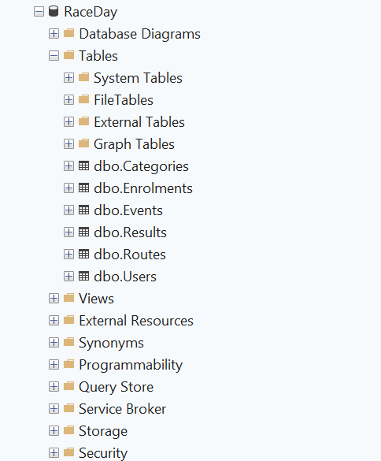

# RaceDay – Sports Event Management System

## 1. System Description

RaceDay is a web-based event management system designed for road running, walking and cycling events in South Africa.

The system provides features for event organisers to manage sporting events and for participants to register, enrol in race categories and view their results.

RaceDay is developed using C# and .NET 8. It consists of an ASP.NET Core Web API, an ASP.NET Core MVC web application and a Microsoft SQL Server database.

## 2. User Roles

### 2.1 Organiser

Organisers can:

- Create, update and delete events.
- Manage event categories.
- Upload event banner images.
- View participant enrolments.
- Record and update participant results.
- Manage route information.
- View results associated with their events.

### 2.2 Participant

Participants can:

- Register an account and log in.
- View and update their profiles.
- Upload profile pictures.
- Browse available events.
- View event details.
- Enrol in event categories.
- View their enrolments.
- View their race results.

## 3. Technologies Used

The following technologies and tools are used:

- **Programming Language:** C#
- **Framework:** ASP.NET Core
- **.NET Version:** .NET 8
- **Frontend:** ASP.NET Core MVC, HTML, CSS and Bootstrap
- **Backend:** ASP.NET Core Web API
- **Database:** Microsoft SQL Server
- **ORM:** Entity Framework Core
- **API Documentation:** Swagger / OpenAPI
- **Cloud Storage:** Microsoft Azure Blob Storage
- **Authentication:** Session-based authentication
- **Unit Testing:** xUnit
- **Containerisation:** Docker
- **Version Control:** Git and GitHub
- **CI/CD:** GitHub Actions
- **Development Environment:** Microsoft Visual Studio

## 4. Database

RaceDay uses Microsoft SQL Server to store and manage application data.

The main database entities include:

- Users
- Events
- Categories
- Enrolments
- Results
- Routes

Entity Framework Core is used to interact with the database through the Web API.

The database design and SQL scripts are available in the `docs` and `Database` folders.

### Database Screenshot

The following screenshot shows the RaceDay database in SQL Server Management Studio.



## 5. Web API

The RaceDay Web API is developed using ASP.NET Core and C#.

The API provides endpoints for:

- User registration and login.
- User profile management.
- Event management.
- Category management.
- Participant enrolments.
- Race results.
- Route information.
- Image uploads and retrieval.

Swagger / OpenAPI is used to inspect and test the API endpoints.

The API project is located in:

`RaceDay.API.Clean`

## 6. ASP.NET Core MVC Application

The MVC application provides the user-facing interface for RaceDay.

It communicates with the Web API using HTTP requests. The MVC application does not access the database directly.

The MVC application provides:

- A homepage displaying upcoming events.
- Event browsing and event details.
- Organiser event management.
- Participant enrolment functionality.
- Participant results.
- User profile management.
- Role-specific navigation and functionality.
- Session-based authentication.

The MVC project is located in:

`RaceDay.MVC`

## 7. Azure Blob Storage

Azure Blob Storage is integrated into the Web API to store images in the cloud.

Two storage containers are used:

- `event-banners` – stores event banner images.
- `profile-pictures` – stores user profile pictures.

Organisers can upload event banners, while both organisers and participants can upload profile pictures.

The API handles image uploads and retrieval, while the MVC application displays the stored images.

Azure storage credentials are configured separately and should not be committed to GitHub.

## 8. Unit Testing

The RaceDay API includes automated unit tests using xUnit.

The tests verify different API operations and help ensure that the application behaves as expected.

The test project is located in:

`RaceDay.API.Tests`

To run the tests:

```bash
dotnet test
```

To build the solution:

```bash
dotnet build --configuration Release
```

## 9. Docker Containerisation

Docker is used to containerise the RaceDay MVC application.

The Dockerfile is located in:

`RaceDay.MVC/Dockerfile`

To build the Docker image, navigate to the MVC project directory:

```bash
cd RaceDay.MVC
```

Build the image:

```bash
docker build -t raceday-mvc:latest .
```

Run the container:

```bash
docker run -d --name raceday-presentation -p 8080:8080 -e "ApiSettings__BaseUrl=http://host.docker.internal:5163/" raceday-mvc:latest
```

The MVC application can then be accessed through:

`http://localhost:8080`

**Important:** The Web API must also be running and accessible on port 5163. The API connects to the SQL Server database and Azure Blob Storage.

To check running containers:

```bash
docker ps
```

To stop the container:

```bash
docker stop raceday-presentation
```

## 10. Running the Application Locally

To run RaceDay locally:

1. Open the RaceDay solution in Microsoft Visual Studio.
2. Ensure SQL Server is running and the database is configured.
3. Configure the required API connection string and Azure storage settings.
4. Start the `RaceDay.API.Clean` project.
5. Start the `RaceDay.MVC` project.
6. Open the MVC application in your browser.

The MVC application communicates with the API to retrieve and manage application data.

## 11. Version Control

Git and GitHub are used to manage the RaceDay source code and track development progress.

The repository includes:

- API source code.
- MVC source code.
- Database documentation and scripts.
- Automated unit tests.
- Docker configuration.
- GitHub Actions workflow.

Project changes are tracked through Git commits and pushed to the GitHub repository.

## 12. Project Repository

GitHub Repository:

https://github.com/bethu25/RaceDay

Development Branch:

`part3-raceday`
