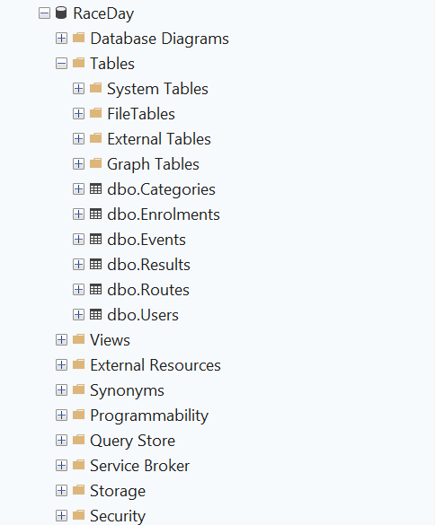

# RaceDay

## 1. System Description

RaceDay is a web-based event management system designed for road running, walking and cycling events in South Africa.

The system provides features for event organisers to manage sporting events and for participants to register, enrol in race categories and view their results. It aims to simplify event administration and provide participants with a convenient way to manage their race activities.

The RaceDay project includes a SQL Server database and an ASP.NET Core Web API developed using C# and .NET 8.

## 2. User Roles

### 2.1 Organiser

The Organiser manages sporting events on the RaceDay system.

Organisers can:

* Create and update events.
* Delete events.
* Create and manage event categories.
* View participant enrolments.
* Record and update participant results.
* Manage route information.
* View results associated with their own events.

### 2.2 Participant

The Participant takes part in events managed through RaceDay.

Participants can:

* Register an account.
* Log in to the system.
* View and update their profile.
* Browse available events.
* Enrol in event categories.
* View their enrolments.
* View their own race results.

## 3. Technologies Used

The following technologies and tools are used in the project:

* **Programming language:** C#
* **Framework:** ASP.NET Core Web API
* **.NET version:** .NET 8
* **Database:** Microsoft SQL Server
* **Object-relational mapper:** Entity Framework Core
* **API documentation and testing:** Swagger / OpenAPI
* **Unit testing:** xUnit
* **Version control:** Git and GitHub
* **CI/CD:** GitHub Actions
* **Development environment:** Microsoft Visual Studio

## 4. Database

RaceDay uses Microsoft SQL Server to store and manage application data.

The database contains the following main entities:

* Users
* Events
* Categories
* Enrolments
* Results
* Routes

Entity Framework Core is used to interact with the database from the API.

The database design and SQL script are available in the `docs` folder.

### Database Screenshot

The following screenshot shows the RaceDay database in SQL Server Management Studio.



## 5. Web API

The RaceDay Web API is developed using ASP.NET Core and C#.

The API provides endpoints for managing application functionality, including:

* User registration and login.
* User profile management.
* Event management.
* Category management.
* Participant enrolments.
* Race results.
* Route information.

The API uses session-based authentication and role-based authorization to control access to protected operations.

The API also includes endpoints for testing database connectivity and session-related functionality.

### API Documentation

Swagger / OpenAPI can be used to inspect and test the API endpoints when the application is running.

To access Swagger, run the API project in Visual Studio and open the Swagger UI address configured for your development environment.

The API endpoint plan is available in:

`docs/API-Endpoint-Plan.md`

## CI/CD

```bash
dotnet build --configuration Release
```

To run the unit tests, run:

```bash
dotnet test --configuration Release
```

## 10. Version Control

Git and GitHub are used to manage the RaceDay source code and track changes throughout development.

The repository contains the application source code, database documentation, automated tests and CI/CD workflow.

Contributions and updates are tracked through commits to maintain a record of the project's development.
